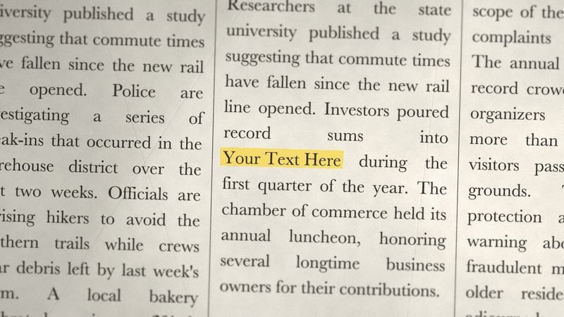
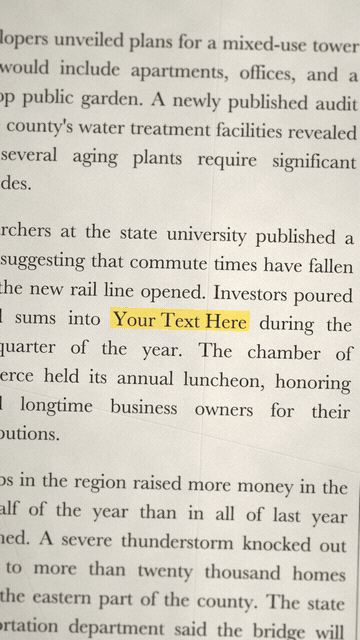

<div align="center">

# 📰 PaperAnimation

### Turn any word into a 3-second newspaper hook, exported in **4K at 60 fps**.

23 newspaper, magazine and web pages flip past, with **your word highlighted in yellow, dead-centre, on every one.**
Reel and YouTube versions, rendered at once.

[](#-what-you-get)

[](#-requirements)
[](#-requirements)
[](#-requirements)
[](https://agentskills.io)
[](#-in-claude-code)
[](LICENSE)


&nbsp;


<sub>A downsized, silent preview. **[🔊 Watch it with the sound](media/demo-with-sound.mp4)**</sub>

<br>

## ⬇️ Get it in 2 minutes. No GitHub needed.

<a href="https://github.com/meetjunaid/PaperAnimation/releases/latest/download/paper-animation.zip"></a>

<sub>One click, and the ZIP lands in your Downloads folder. Keep it zipped.</sub>

**Then pick where you use AI:**

[](#-on-claudeai)
[](#-on-chatgpt)
[](#-in-claude-code)

</div>

---

## ✨ What you get

| | |
| --- | --- |
| 🎬 **4K · 60 fps** | Two finished videos per run: reel **2160 × 3840** and YouTube **3840 × 2160** |
| 🖍️ **Your word, dead-centre** | 23 pages from newspapers, magazines, web articles, a memo and a tabloid finale, with your word always on the exact centre of the frame |
| 🔊 **Optional projector sound** | A fast mechanical rattle, synthesised in code, so there's nothing to license |
| 💻 **Runs everywhere** | macOS, Windows and Linux |
| ✅ **Checks its own work** | Frame count, frame rate, duration and sound, plus a contact sheet of every page |

No templates to buy, no After Effects, no keyframes. Every page is drawn from scratch:
newsprint fibres, creases, ink bleed, marker streaks and film grain.

## 💬 On Claude.ai

Works on every plan, including Free, in the browser and the desktop app.

1. **[Download the skill](https://github.com/meetjunaid/PaperAnimation/releases/latest/download/paper-animation.zip)**. Keep it as a ZIP; don't unzip it.
2. In Claude, open **Settings → Capabilities** and turn on **Code execution and file creation**.
3. Open **Customize → Skills**, click **+**, then **Create skill → Upload a skill**, and choose the ZIP.
4. Start a new chat and type: **make the newspaper highlight video**

Claude asks for your word and whether you want sound, then hands you both 4K videos to download.

> [!NOTE]
> On Team and Enterprise plans, an admin may need to allow skills and code execution first.

## 💬 On ChatGPT

Skills are in beta on ChatGPT, so menus can move around and availability depends on your plan.

1. **[Download the skill](https://github.com/meetjunaid/PaperAnimation/releases/latest/download/paper-animation.zip)**. Keep it as a ZIP.
2. In ChatGPT, open **Skills**, click **Create**, then **Upload from your computer**, and choose the ZIP.
3. In a new chat, type **@paper-animation** or just ask for **the newspaper highlight video**.

## 💻 In Claude Code

```text
/plugin marketplace add meetjunaid/PaperAnimation
/plugin install paper-animation@paper-animation
```

Update later with `claude plugin update paper-animation@paper-animation`.

<details>
<summary><b>Codex, Cursor and other coding agents</b></summary>

<br>

```sh
npx skills add meetjunaid/PaperAnimation
```

or, with the GitHub CLI (v2.90+):

```sh
gh skill install meetjunaid/PaperAnimation paper-animation
```

Or unzip the [ZIP](https://github.com/meetjunaid/PaperAnimation/releases/latest/download/paper-animation.zip) into the folder where your agent looks for skills.

</details>

## ✍️ Use it

Ask your agent for it in plain words:

```text
> make the newspaper highlight video
```

It asks you two quick questions, **what word to highlight** and **whether you want sound effects**
(yes or no), then renders both videos. On your computer they land in
`~/Downloads/paper-animation/`; on Claude.ai and ChatGPT you download them from the chat.

<details>
<summary><b>Prefer the terminal?</b></summary>

<br>

```sh
python3 skills/paper-animation/scripts/make.py "Your Phrase" [output_dir] [--sound]
```

On Windows, use `py` instead of `python3`.

</details>

## 🧰 Requirements

| | |
| --- | --- |
| 🌐 **On Claude.ai or ChatGPT** | Nothing. It runs in the chat's own sandbox |
| 🐍 **On your computer: Python 3.11+** | From [python.org](https://www.python.org/downloads/), or `brew install python` on a Mac |
| 💾 **About 250 MB** | Installed automatically, once, on the first run |
| ⏱️ **Render time** | About 2 minutes on Apple Silicon (hardware encoder), about 5–10 minutes elsewhere |
| 🐧 **Minimal Linux only** | Desktop Linux is ready to go. Servers and containers need `sudo apt install libegl1 libgl1`, and the skill tells you if so |

## 💌 FAQ

<details>
<summary><b>Is it really 4K on Claude.ai and ChatGPT?</b></summary>

<br>

Yes, 4K at 60 fps. Web chats cap downloads at 30 MB per file, so there each video is
encoded at about 25 MB instead of about 75 MB. Side by side at 100% zoom, you can't tell them apart.

</details>

<details>
<summary><b>Will it look the same on Windows and Linux?</b></summary>

<br>

Same pages, same layout, same highlight. The design uses classic macOS typefaces
(Didot, Bodoni, Baskerville…). Where a system doesn't have them, the skill uses
bundled open-licensed lookalikes, so the type differs only slightly.

</details>

<details>
<summary><b>Can I tweak the sound?</b></summary>

<br>

Yes. Speed, loudness, tone, click length and hiss are all at the top of
[`scripts/sound.py`](skills/paper-animation/scripts/sound.py).

</details>

<details>
<summary><b>Will the same word give me the same video?</b></summary>

<br>

Yes. The pages are seeded from your phrase. Only the film grain is fresh on every frame, like real film.

</details>

<details>
<summary><b>Can I change the look?</b></summary>

<br>

Fork it and edit `scripts/render.py` (the pages) and `scripts/copy_text.py` (all the
fictional news). The full design spec is in
[`references/look.md`](skills/paper-animation/references/look.md).

</details>

## 📜 License

PaperAnimation is an independent open-source project. It is not affiliated with, or endorsed by, paperanimation.ai.

[MIT](LICENSE) © 2026 Junaid Ahmed. Bundled fonts are under the SIL Open Font License; see
[`assets/fonts`](skills/paper-animation/assets/fonts/).

<div align="center"><sub>⭐ Star the repo if it made your next video pop.</sub></div>
